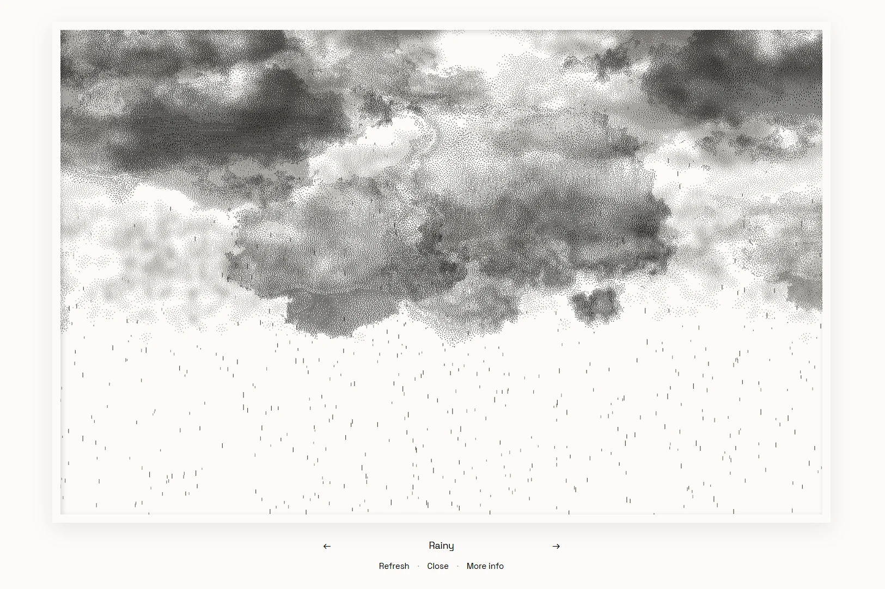
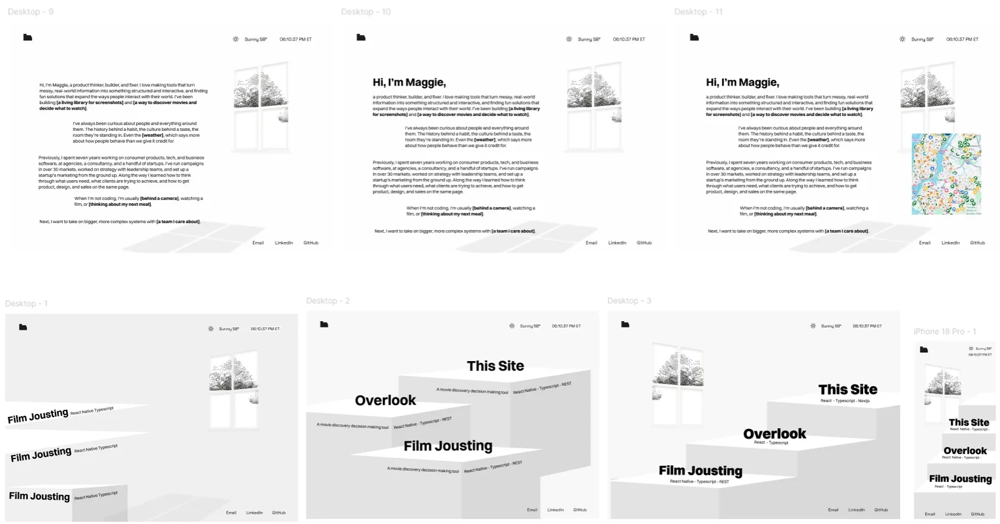

# maggiemshen.com

My portfolio, built as a house: a portfolio as your home on the internet. The homepage intro is a house made of text, the links are doors, and the pages behind them are rooms. Above it all is a dithered sky that follows New York's live weather.

**Live:** [maggiemshen.com](https://maggiemshen.com) · **Case study:** [maggiemshen.com/projects/this-site](https://maggiemshen.com/projects/this-site)


## The sky



- **Live weather.** The server fetches Open-Meteo's current New York weather with Next's `"use cache"`, so it's already in the page on load and visitors share one fetch. One function maps the weather code to one of five skies (`sunny`, `partly-cloudy`, `cloudy`, `rainy` or `snowy`), and it falls back to sunny if the call fails.
- **A new sky every visit.** Each sky is a curated preset. A random seed picks which clouds appear and each one's size and height, and the same sky follows visitors from page to page until they refresh.
- **Dithered in the browser.** Clouds are grayscale photo cutouts, dithered with Floyd–Steinberg on a canvas at the exact pixel size they're drawn. Scaling an already dithered image breaks the dot pattern.
- **Depth.** Clouds sit in three layers, near, middle and far. Farther clouds print in lighter dots. Near clouds scatter quickly from the cursor or a finger, and middle clouds drift apart more slowly.
- **Tuned as data.** I composed each weather's preset in a dev-only `/lab` route and saved it as JSON in `features/sky/config/`, separate from the engine code.

## Rooms and doors

- Page transitions use the View Transitions API to feel like walking up to, into and out of rooms. The direction comes from how deep each page sits.
- Big links swing open like doors, toward the viewer.
- One shared sky lives in the site shell behind every page: Home shows all of it, and About and Projects show it through a window.
- A weather and clock line at the top of every page ticks in New York time.
- With `prefers-reduced-motion`, transitions and door swings become fades, and the clouds stop drifting and the rain hangs still, but their dots still scatter when you touch them. Animations pause when the tab is hidden.

## How I built it



I designed every page in Figma and wrote a spec for each feature before writing any code. The specs live in [`docs/specs/`](docs/specs/), and they made the work divisible across several Claude Code agents running in parallel on separate branches. I reviewed each branch before merging it.

**Stack:** Next.js 16 (App Router), React 19, TypeScript 7 (strict), Tailwind CSS v4, Canvas, Biome, Vercel and Vercel Blob.

```
app/                 routes, one folder per page
components/          site shell: weather/clock line, door links, footer
features/sky/        the dithered weather sky, self-contained
features/weather/    Open-Meteo fetch, weather → sky mapping, sun and moon positions
features/transitions/ page transitions by page depth, back/forward handling
features/projects/   the Projects page's platforms
content/             all site copy, separate from components
docs/specs/          one spec per feature
```

## Run it locally

You need Node 26.

```bash
git clone https://github.com/m-m-s/portfolio.git
cd portfolio
npm install
npm run dev        # http://localhost:3000
```

**Fonts:** Switzer's license (ITF FFL) allows self-hosting but not sharing the font files, so they aren't in this repo. Download Switzer from [Fontshare](https://www.fontshare.com/fonts/switzer) and put `Switzer-Variable.woff2` and `Switzer-VariableItalic.woff2` in `app/fonts/`. On Vercel, a prebuild script pulls them from a private Blob store. Space Grotesk (OFL) is included.

**Photos:** the photography gallery's photos also come from a private Blob store, so a local copy shows placeholders.

| Command | |
| --- | --- |
| `npm run dev` | dev server (the `/lab` sky tuner only exists here) |
| `npm run preview` | production build, served locally |
| `npm run lint` | Biome lint and format check |
| `npm run typecheck` | route types + `tsc --noEmit` |

## Credits

Weather data by [Open-Meteo.com](https://open-meteo.com/). Fonts: Switzer by Indian Type Foundry, Space Grotesk by Florian Karsten.
